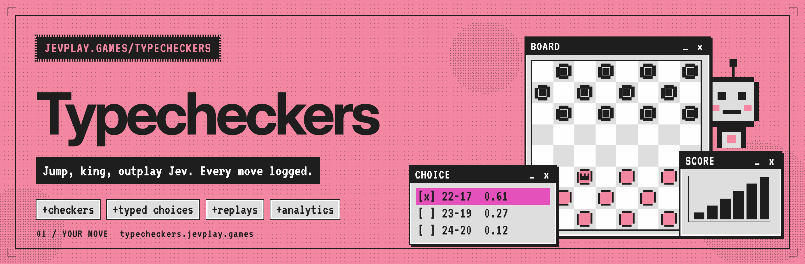
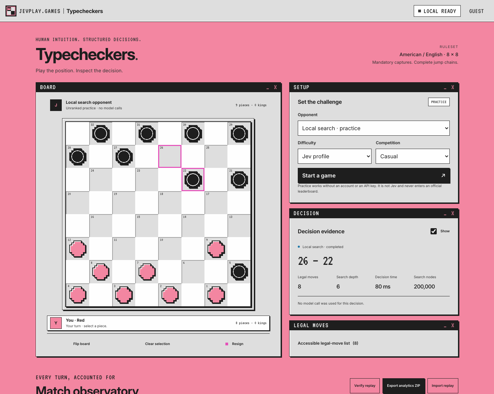
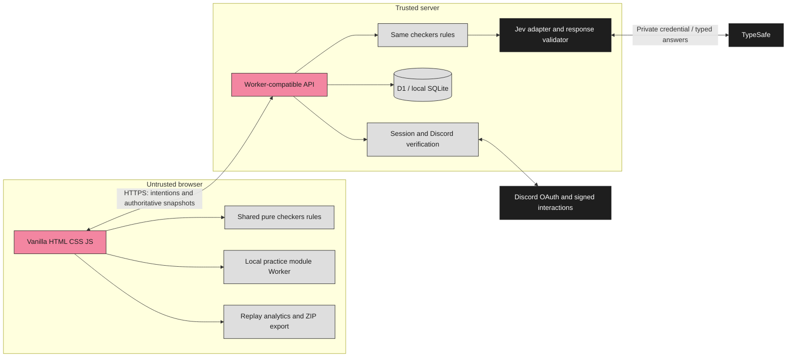

<p align="center"></p>

<div align="center">

# Typecheckers

**American checkers against Jev, where every Jev move is a typed choice you can inspect, replay and verify.**

[](https://typecheckers.jevplay.games)
[](#release-limitations)
[](#quick-start)
[](LICENSE)

[Quick start](#quick-start) · [How it works](#how-it-works) · [Features](#features) · [Analytics](#analytics-and-exports) · [Discord](#configure-discord) · [Deploy](#deploy-to-cloudflare) · [Docs](#documentation)

</div>

---

Typecheckers is a single-page American checkers game from jevplay.games. You play Jev, and each of Jev's moves comes with the legal candidates it weighed, the search behind them and the answers that changed the order. Server matches are authoritative and hash-linked, so a ranked result can be replayed and checked move by move.

> [!NOTE]
> Local practice works offline and needs no account. Playing the real Jev needs a TypeSafe API key; Discord credentials are needed for sign-in, community launch and leaderboards. This repository holds the integrations but no credentials, no deployed service and no Jev benchmark results: none were measured, so none are shown.

<p align="center"></p>

## Quick start

Install **Node.js 22.16 or later**, then:

```sh
git clone https://github.com/jevplays-games/jev-checkers-analytics.git jev-typecheckers
cd jev-typecheckers
npm start
```

Open `http://127.0.0.1:8787`. No `npm install` is needed for local play, the API, unit tests or the command-line analytics tools. SQLite comes with Node; Node 22 may print its experimental SQLite warning.

The development server listens on loopback, creates `.data/typecheckers.sqlite`, and runs the same API as the Worker deployment. It is a development runner, not a hardened internet-facing server.

The default opponent is **Local search · practice**. Local practice is not Jev and never enters an official leaderboard. Select a piece and a destination, or use the accessible legal-move list. A capture can need several destinations before the turn is submitted.

## How it works



The same pure rules engine runs local play, server play, replay, analytics and benchmarks. The browser sends intentions; the server owns the board, the Jev call and the record. More in [Architecture](docs/ARCHITECTURE.md).

## Features

- American/English checkers: mandatory captures, complete branching multi-jumps, short kings, forward-only men, crown-row termination, blocked-player defeat, deterministic web draw adjudication.
- Easy, Normal, Hard, and Jev profiles: deterministic search budgets and structured positional questions rather than random mistakes.
- Real server-only Jev integration with typed Score/Noul answers, validation, bounded retries, frozen profiles, and explicitly labeled forced decisions.
- Live board, keyboard navigation, mobile layout, reduced-motion support, rules panel, decision evidence, complete candidate comparison, replay scrubber, and import/export.
- Material and mobility timelines, latency distributions, search accounting, piece statistics, phase counts, heatmaps, model-answer entropy, token accounting, failures/retries, and full event records.
- One-click **11-file analytics ZIP**, plus CSV/JSON/NDJSON exports and offline CLI reconstruction.
- Discord `identify` OAuth, signed guild slash-command launch, account-bound single-use context, Channel/Server/World leaderboards, and owner-scoped history.
- Server-authoritative turns, revision checks, leases, idempotency, SHA-256-linked records, replay/provenance verification, quotas, and no-contest handling.
- Headless paired-color benchmarks, including an explicit same-search-budget Jev ablation mode.

## Configure real Jev

Copy `.env.example` to `.env` and set:

```dotenv
TYPESAFE_API_KEY=your_private_key
```

Restart the server. The Jev option becomes available. The frozen profiles request `jev-1.13.0`; model output is not assumed to be repeatable, so accepted responses are recorded for deterministic decision reconstruction.

No API key is sent to the browser. Missing credentials do not activate a simulated Jev. A provider failure ends a remote match as a no-contest and offers a clearly labeled local continuation, never an official substituted result.

## Configure Discord

In the Discord developer application:

1. Add the OAuth redirect `http://127.0.0.1:8787/api/auth/discord/callback` for local identity testing, where supported by Discord, or your deployed HTTPS equivalent.
2. Set `DISCORD_APPLICATION_ID` and `DISCORD_CLIENT_SECRET` in the server environment. Identity requests only the `identify` scope.
3. For community launch, also set `DISCORD_PUBLIC_KEY`, deploy a public HTTPS endpoint, and register that origin's `/api/discord/interactions` as the interaction endpoint.
4. Run `npm run discord:register` with the application credentials. This upserts `/play typecheckers`; it does not bulk-delete other commands. The server still accepts the pre-rename `/play checkers` until that subcommand is deregistered.
5. Enable guild installation and install with `applications.commands`. The implementation uses signed HTTP interactions, not a persistent bot connection.

The interaction is restricted to ordinary guild text channels. It produces a private, ten-minute, account-bound launch link. A fresh interaction establishes short-lived community access; it does not continuously monitor channel membership.

Set `APP_ORIGIN` to the exact origin used in the browser. It is used for redirects, same-origin checks, cookies, and launch links. Do not interchange `localhost` and `127.0.0.1` during a session.

## Analytics and exports

The match observatory contains Overview, Decisions, Replay, Event audit, Leaderboards, and My history. All recorded turns are used; per-match analytics do not sample moves.

Click **Export analytics ZIP** for `replay.json`, `summary.json`, `manifest.json`, move/candidate/position/event CSVs, event/operation NDJSON, heatmaps, and a provenance note. For server matches, the exporter fetches all owned operational pages before producing the archive. Imported/local records cannot independently retrieve server operational records.

```sh
npm run verify -- reports/example-replay.json
node scripts/analyze-replay.mjs reports/example-replay.json ./analysis-output
```

See [the metric dictionary](docs/ANALYTICS.md). Important distinctions: human elapsed time is not active attention; model confidence is not win probability; heuristic regret is not a solved value; missing usage is unknown, not zero billed usage. Dollar cost is deliberately unestimated.

## Test and benchmark

```sh
npm test
npm run bench -- --pairs 4 --profile easy --opponent random --out bench/results/random
npm run bench -- --pairs 4 --profile easy --opponent heuristic --out bench/results/heuristic
```

A real Jev experiment requires an explicit billable opt-in:

```sh
npm run bench -- --pairs 4 --profile normal --opponent heuristic --ablation --allow-remote --out bench/results/jev-ablation
```

`--ablation` compares Jev+search with identical-budget search-only against the same opponent, on matching positions and both colors. No provider access means no remote experiment. Move-cap games are reported as truncated, not draws.

Optional browser/deployment tools are not runtime dependencies:

```sh
npm install --save-dev @playwright/test wrangler
npx playwright install chromium
npm run test:e2e
```

The standard Playwright suite uses a real browser server and module Worker. This suite is supplied for normal environments. The included build reports distinguish it from the source-loaded Chromium checks performed in this restricted build environment.

## Deploy to Cloudflare

After installing Wrangler as above:

```sh
npx wrangler login
npx wrangler d1 create checkers   # the production database keeps this name after the rename
```

Put the returned database ID in `wrangler.jsonc`, replace the host placeholder with your intended HTTPS origin, and set the Discord application ID/public key as configuration. Keep secrets out of the configuration file:

```sh
npx wrangler secret put TYPESAFE_API_KEY
npx wrangler secret put DISCORD_CLIENT_SECRET
npx wrangler secret put ANALYTICS_ADMIN_TOKEN
npm run db:remote
npm run deploy
```

Set the origin and register the Discord redirect/interaction URLs consistently. For `wrangler dev`, use a git-ignored `.dev.vars` file for private local bindings. Do not publish `.env`, `.dev.vars`, local databases, or operator tokens.

The deployment includes static assets, one Worker, one D1 database, and a five-minute recovery/cleanup schedule. Verify search CPU cost against the configured Worker plan before enabling larger profiles. D1 batch semantics and live external integration require staging validation; see [VALIDATION.md](docs/VALIDATION.md).

Initial safety limits are five guest remote match starts per day, thirty authenticated starts per day, and a global limit of 200 (configurable). These are coarse safeguards, not a dollar-budget guarantee. Add provider-side spending controls before public exposure.

The production Worker serves `typecheckers.jevplay.games` and, until the redirect cutover, the pre-rename hostname. See [Deployment](docs/DEPLOYMENT.md#checkers--typecheckers-rename-hostnames-worker-d1).

## Reports included

`reports/` contains the test transcript, browser check report, desktop/mobile previews (`desktop-preview.png`, `desktop-preview-top.png`, `mobile-preview.png`, retaken after the jevplay.games restyle), an actual browser-generated export/replay, and two search-only paired benchmark runs. No live Jev result is represented as measured here.

## Repository layout

```text
assets/                 README banner and GitHub social preview
  src/                  HTML sources for the banner, social preview and OG card; render.py re-renders them and the PNG icons
public/                 browser app: index.html, game.js, game.css
  brand/                shared jevplay.games brand.css, fonts (Inter, VT323), icons, OG card and result badges
  art/                  piece SVGs (red, dark, red-king, dark-king)
  games/checkers/       pure rules, search engine and strategy
  lib/                  audit (hash chain, replay verification), analytics, ZIP writer
server/                 Worker API: matches, Jev adapter, auth, Discord, leaderboards
migrations/             D1 / SQLite schema
scripts/                dev server, replay verify/analyze, Discord registration
bench/                  paired-colour benchmark harness
tests/                  node:test suites (+ tests/browser for Playwright)
docs/                   architecture, API, analytics, deployment, security, validation
reports/                captured test, browser and benchmark output
wrangler.jsonc          Cloudflare Worker, routes, D1 binding
```

## Documentation

- [Architecture and diagrams](docs/ARCHITECTURE.md)
- [Analytics semantics and retention](docs/ANALYTICS.md)
- [API and export endpoints](docs/API.md)
- [Trust, privacy, and deployment checklist](docs/SECURITY.md)
- [Validation evidence and known limits](docs/VALIDATION.md)
- [External technical references](docs/SOURCES.md)
- [Deployment, including the Checkers → Typecheckers rename](docs/DEPLOYMENT.md)
- [Discord Activity](docs/ACTIVITY.md)

Additional games can reuse the identity, context, session, audit, provider, and leaderboard boundaries. The checkers rules and strategy stay under `public/games/checkers/` (the directory keeps the name of the game it implements).

## Release limitations

This is a source release, not a deployment or security certification. A valid hash chain alone does not authenticate a downloaded replay. Official status is established only by the server's recorded provenance. Outside engine assistance, multiple Discord accounts, and continuous membership monitoring are not solved. Local-storage failure can lose an unfinished practice game; export records you need to retain.

## Contributing

Issues and pull requests are welcome. Run `npm test` before opening a pull request and keep the rules engine pure and deterministic. A change to a replay format or stored identifier must keep older records verifying. `tests/rename.test.js` shows the pattern.

<p align="center"><sub>A jevplay.games game · Steward: CompleteTech LLC · MIT licensed<br>
Not an official TypeSafe AI publication; the pink, ink and pixel-window styling is a nod to <a href="https://typesafe.ai">typesafe.ai</a>. Jev, System One and TypeSafe are their respective owners' names.</sub></p>
